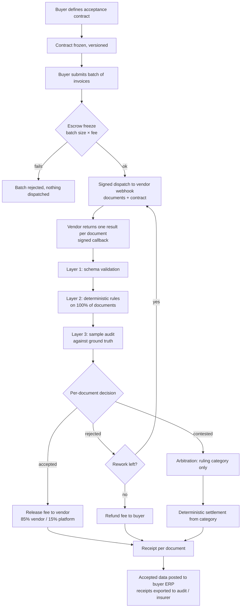
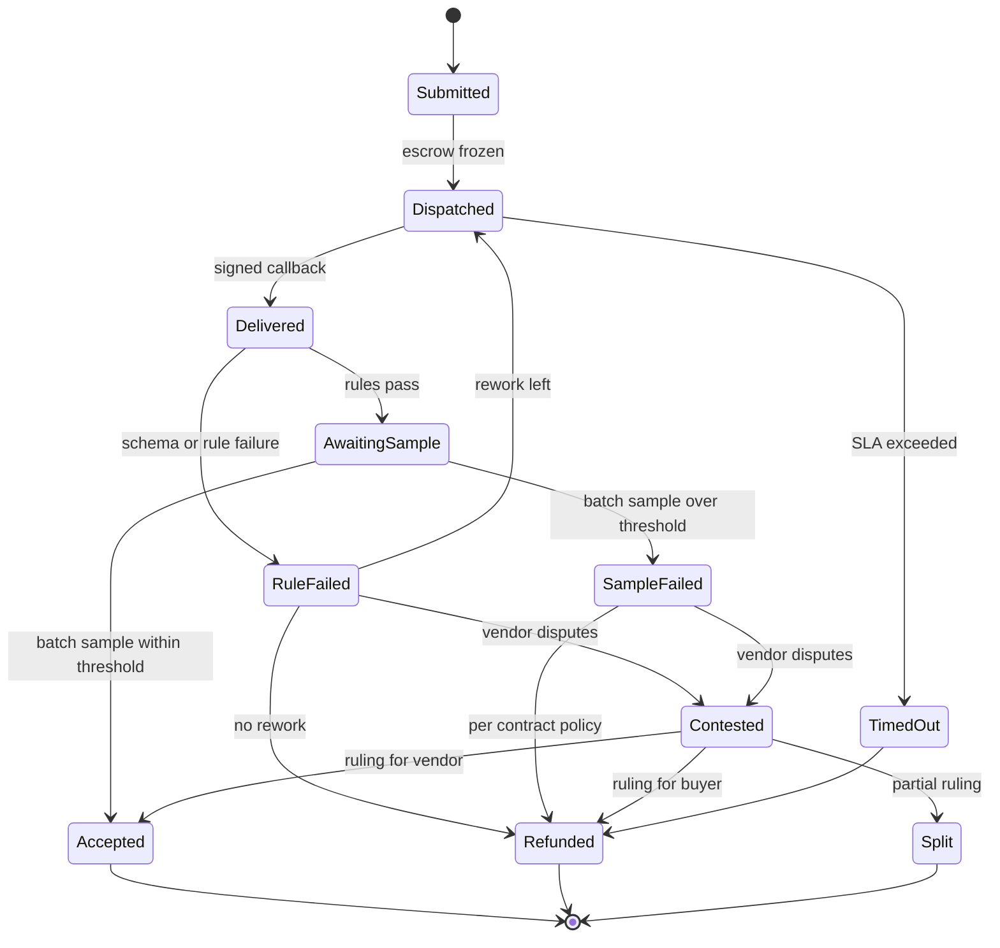

# Wedge: acceptance-before-payment for AI invoice processing

- **Date:** 2026-11-09
- **Status:** Proposed strategy. It is not built, and no buyer has validated it.
- **Scope:** This document evaluates the idea, not the current build. Gaps against today's code are listed in §7 only so the delta is visible.
- **Companion:** [`2026-11-09-acceptance-infrastructure-thesis.md`](2026-11-09-acceptance-infrastructure-thesis.md) covers the long-term thesis: acceptance as shared industry infrastructure.
- **Related:** [shaoxian04/HireAI#46](https://github.com/shaoxian04/HireAI/issues/46), the binding-contract redesign. The verification-mechanism design for this wedge is being worked out together with it.
- **Evidence base:** `reports/AIaaS 验证层缺口与潜力.md` and `research_notes/` (uncommitted research). Statements marked **(judgment)** are reasoning, not findings. Statements marked **(assumption)** are numbers chosen for illustration.

## 1. The wedge in one sentence

A company hands its incoming supplier invoices to one or more AI extraction vendors. HireAI checks every returned document against a frozen acceptance contract **before the vendor is paid** and settles per accepted document. It also issues a verifiable receipt that the buyer's ERP, auditors and insurers can rely on.

This is the Cass Information Systems model (audit, then pay) applied to AI work. Cass is buyer-paid, both audits and pays, and processed $38B of freight payables in 2023 ([Cass investor presentation](https://www.sec.gov/Archives/edgar/data/708781/000070878124000004/investorpresentationq420.htm)).

> **Terminology:** two kinds of payment appear in this domain, and they must not be confused.
> - The **service fee** is what the buyer pays the AI vendor for processing a document. HireAI escrows and releases it.
> - The **invoice payment** is what the buyer pays its own supplier for goods. It stays in the buyer's ERP and is **out of scope**.
>
> Gating invoice payment on HireAI's acceptance is a possible later extension, not part of the wedge.

## 2. Why this wedge

### 2.1 Selection rules

Six rules came out of the research. Each candidate wedge was scored against them.

1. **The deliverable lands in the buyer's own systems.** Verification must not depend on the vendor exporting its internal logs. Outcome-priced vendors are walled gardens today: Intercom counts its own "assumed" resolutions after 24h of silence ([Intercom](https://www.intercom.com/help/en/articles/8205718-fin-resolutions-how-are-they-measured)). Zendesk verifies resolutions with its own LLM ([Zendesk](https://support.zendesk.com/hc/en-us/articles/9570369117338-About-automated-resolution-tiers)). Historically, walled gardens opened to third-party measurement only under boycott pressure ([MarTech on YouTube 2017](https://martech.org/google-youtube-brand-safety-timeine/)).
2. **Acceptance can be checked mechanically.** Most acceptance decisions must be deterministic, so the LLM arbitrator is the exception and never the money path (hard invariant #3).
3. **Acceptance before payment is already the buyer's habit.** HireAI should not have to teach the market a new behaviour.
4. **The buyer pays.** This avoids the issuer-pays conflict that cost S&P $1.375B in 2015 ([ABA Journal](https://www.abajournal.com/news/article/ratings_agency_to_pay_nearly_1.4b_to_resolve_allegations_it_inflated_rating)).
5. **It survives better models.** If stronger models remove the need, the wedge dies with the next release.
6. **It maps onto HireAI's existing primitives:** frozen spec, escrow, deterministic settlement, append-only ledger, arbitration.

### 2.2 Candidates scored

| Candidate | Rule 1 | Rule 2 | Rule 3 | Rule 4 | Rule 5 | Verdict |
|---|---|---|---|---|---|---|
| **AP invoice extraction** | ✅ data lands in ERP | ✅ sums, tax, PO, vendor master | ✅ three-way match is standard AP practice | ✅ | ✅ value is proof, not accuracy | **Chosen** |
| Customer-support resolutions | ❌ inside Intercom or Zendesk | ⚠ "resolved" is subjective | ❌ | ⚠ | ⚠ | Rejected: walled garden, about $1 unit price, top vendors already AIUC-1 certified ([AIUC-1](https://www.aiuc-1.com/)) |
| Code and engineering tasks | ✅ | ✅ tests | ⚠ CI already does it | ✅ | ❌ absorbed by model and CI progress | Rejected |
| Security testing | ✅ | ⚠ | ⚠ | ✅ | ⚠ | Demo-worthy, too narrow for the main line |
| Insurance claims intake | ✅ | ✅ | ✅ | ✅ | ✅ | **Second category:** regulated and slower to sell |
| Financial reconciliation | ✅ | ✅ | ✅ | ✅ | ✅ | Too ERP-coupled for a solo founder at the start |

### 2.3 The evidence behind the choice

- **A ready-made acceptance clause already exists in legal practice.** Mayer Brown (Feb 2026) recommends replacing SaaS-style uptime SLAs with BPO-style outcome SLAs, using **"99% of invoices processed correctly against the purchase order"** as its example, plus structured decision logs ([Mayer Brown](https://www.mayerbrown.com/en/insights/publications/2026/02/contracting-for-agentic-ai-solutions-shifting-the-model-from-saas-to-services)). The wedge sells the neutral enforcement of exactly that clause.
- **Accuracy is good but not good enough to skip checking.**
  - Vendor-claimed header-level accuracy on clean digital invoices is 95–99%, and vendor-claimed straight-through processing (STP) is 85–92% at high volume ([Hypatos](https://www.hypatos.ai/knowledge-base/invoice-processing-accuracy-benchmarks-idp), vendor).
  - A low-authority report puts blended rates at 45–65% and says 90%+ claims usually describe the best subset ([ProcurementAIAgents](https://procurement-ai-agents.pages.dev/reports/invoice-ai-touchless-processing-data)).
  - Handwritten form extraction is 80–84%, with hallucinated values in blank fields ([Trail IDP leaderboard](https://trailhq.com/blog/idp-leaderboard-1-5), vendor).
  - Vendor figures are typically measured on clean demo sets ([idp-software.com](https://idp-software.com/capabilities/quality-verification/)).
- **Every accuracy guarantee in this market today is the seller grading its own homework.**
  - Infrrd sells a "High Document Accuracy Guarantee" by quote, using human-in-the-loop review ([Infrrd](https://www.infrrd.ai/pricing)).
  - Hyperscience meets accuracy SLAs with its own sampling and human review ([Hyperscience](https://www.hyperscience.ai/resource/accuracy-harness/)).
  - API-tier vendors (Reducto, Extend) publish no accuracy guarantee ([Reducto](https://reducto.ai/pricing), [Extend](https://www.extend.ai/pricing)).
  - No neutral, escrow-backed guarantee was found.
- **Unit prices are low, so verification must be cheap and mostly automatic.** Schema extraction lists at about $10–$50 per 1,000 pages ([Reducto](https://reducto.ai/pricing), [Extend](https://www.extend.ai/pricing)). An LLM arbitration call costs about $0.10–$1 per dispute (my calculation in the notes). The economics therefore only work if most documents settle deterministically and escrow runs per batch, not per $0.02 page.
- **Insurers need exactly this data.** Armilla pays out when accuracy falls "below a verified threshold" ([Armilla](https://www.armilla.ai/enterprise)). Munich Re aiSure relies on the client establishing ground truth to track drift ([Munich Re](https://www.munichre.com/en/solutions/for-industry-clients/insure-ai/faq.html)). Meanwhile mainstream policies are adding generative-AI exclusions ([Insurance Journal](https://www.insurancejournal.com/magazines/mag-features/2026/08/17/881424.htm)).

### 2.4 Why it survives better models (judgment)

As extraction accuracy rises, the scarce thing moves from *getting the right answer* to *proving the answer was right, document by document, to someone who did not produce it*. That is what an auditor, a SOX control owner, an insurer, or a buyer switching between vendors needs. HireAI sells that proof plus the money movement tied to it, not extraction.

**The risk:** if accuracy reaches 99.9% and auditors accept vendor self-attestation, the wedge loses most of its value. See §8.

## 3. Actors

| Actor | Role | What they want |
|---|---|---|
| **Buyer** (AP manager, finance ops lead, controller) | Writes the acceptance contract and funds escrow; owns the ERP and the source invoices | Pay only for correct documents, have evidence for audit, switch vendors freely |
| **Vendor** (AI IDP vendor, AI BPO, or a self-hosted agent) | Processes documents through the HireAI webhook and earns fees on accepted documents | Predictable acceptance rules, fast settlement, a fair appeal |
| **HireAI** | Freezes the contract, verifies, holds escrow, settles, arbitrates, issues receipts | Stays neutral; never moves money on an LLM's say-so |
| **Reviewer** (buyer's AP clerk, a HireAI reviewer pool, or a second vendor) | Supplies ground truth for sampled documents | Low effort per sample |
| **Insurer or auditor** (downstream, optional) | Consumes receipts and aggregate accuracy as evidence | Comparable, tamper-evident data |

The buyer brings its own vendors. HireAI does not need to run a marketplace for the wedge to work; discovery and routing are optional add-ons.

## 4. The acceptance contract

The contract is frozen when an engagement (or a batch) is created. It generalises today's `output_spec` and is the single source of truth for both automated verification and arbitration (hard invariant #4). An illustrative shape (not a final schema):

```yaml
contract_version: 3
category: ap_invoice_extraction
document_types: [pdf, png, jpg]
output_schema:                 # JSON Schema for one document's result
  required: [supplier_name, supplier_tax_id, invoice_number, invoice_date,
             currency, line_items, subtotal, tax_total, grand_total, po_number]
rules:                         # deterministic, evaluated on 100% of documents
  - id: R1  sum_lines          # sum(line_items.amount) == subtotal ± 0.01
  - id: R2  totals             # subtotal + tax_total == grand_total ± 0.01
  - id: R3  supplier_known     # supplier_tax_id ∈ buyer vendor master
  - id: R4  po_exists          # po_number ∈ buyer open POs
  - id: R5  no_duplicate       # (supplier_tax_id, invoice_number) not seen before
  - id: R6  date_sane          # invoice_date within [today-365d, today+7d]
  - id: R7  evidence           # every required field carries a page + bounding box
sampling:                      # ground-truth audit on a sample of rule-passing docs
  plan: per_batch
  sample_size: 32              # or an AQL-style table keyed by batch size
  field_tolerance: exact | normalised | numeric(±0.01)
  batch_accept_if_field_error_rate_lte: 0.01
pricing:
  fee_per_accepted_document: 0.80   # (assumption) currency units
  rework_window_hours: 24
  max_rework_attempts: 1
dispute:
  vendor_may_contest: [rule_failure, sample_judgement]
  window_hours: 72
```

Rules that read buyer reference data (R3–R5) need a read-only connector to the buyer's ERP or a nightly reference-data upload. This is the main integration cost of the wedge.

## 5. End-to-end flow

### 5.1 Overview



### 5.2 Step by step

1. **Engagement setup (once per vendor relationship).**
   - The buyer picks a category template (`ap_invoice_extraction`), edits fields, rules and thresholds, and connects reference data.
   - The vendor reviews the contract and accepts it. A vendor that has not accepted the contract cannot be dispatched to, so neither side can later claim it did not know the rules.
2. **Batch submission and escrow.**
   - The buyer uploads a batch (for example the day's 500 invoices).
   - HireAI freezes `batch_size × fee_per_accepted_document` from the buyer's balance. There is no dispatch without a successful freeze (hard invariant #1).
   - The contract version is stamped on the batch.
3. **Dispatch.**
   - Documents and the contract go to the vendor's HTTPS webhook with a short-lived signed token (hard invariant #6).
   - The vendor must receive the actual documents and schema, not just a category. Today's build has a gap here (§7).
4. **Delivery.**
   - The vendor calls back once per document, or once per chunk, with structured output, per-field evidence (page and bounding box) and optional confidence.
   - Callbacks without a valid, unexpired token are rejected with 401.
5. **Verification, in three layers, cheapest first.**
   - **Layer 1, schema:** the output must parse and validate against `output_schema`. A failure rejects that document immediately.
   - **Layer 2, deterministic rules:** R1–R7 run on every document. Any failure rejects that document, and the receipt names the failing rule.
   - **Layer 3, sample audit:** for documents that pass Layers 1–2, HireAI draws a random sample (the seed is recorded in the receipt). A reviewer, or an independent second extraction, produces ground truth, and HireAI compares fields by the contract's tolerances.
     - If the field error rate is at or below the threshold, every rule-passing document in the batch is accepted.
     - If it is above the threshold, the batch outcome follows the contract: escalate to a larger sample, partial pay, or batch rework. The exact policy is an open design question (§9).
6. **Decision and settlement, per document.**
   - **Accepted:** the fee is released from escrow and split 85/15 by the domain layer.
   - **Rejected with rework left:** the document is redispatched with the failing rules attached.
   - **Rejected with no rework left:** the fee is refunded to the buyer.
   - Every movement is an append-only ledger entry (hard invariant #2).
7. **Dispute.**
   - A vendor may contest a rejection (for example "R3 failed because the buyer's vendor master was stale") or a sample judgement, within the window.
   - The arbitrator reads the source document, the contract and the evidence, and returns only a **ruling category**. The domain layer computes the money movement from that category (hard invariant #3).
   - Rule failures caused by buyer reference data are a distinct category, so the vendor is not penalised for the buyer's stale data.
8. **Receipt and hand-off.**
   - Each document gets a receipt: contract version and hash, input hash, output hash, the result of every rule, sample membership and judgement, ruling (if any), and the ledger entry IDs.
   - Accepted data is posted to the ERP, or exported for the buyer's posting job.
   - Receipts are exportable for auditors and insurers.

### 5.3 Document state machine



## 6. Economics (assumptions, not findings)

- **Service fee window:** about $1–$5 per verified document is the plausible window in which verified output displaces human review. Below that, an unverified $1 result is just an expensive API call (notes, `document_extraction_market.md`, my calculation).
- **HireAI take:** about 15% of the service fee, plus an optional SaaS fee for the reviewer workflow and receipt exports. The total verification cost must stay **below about 2% of the value of the work being protected** for the buyer to treat it as overhead (judgment).
- **Cost floor:** LLM arbitration is about $0.10–$1 per dispute. Human ground truth on samples is the real cost driver, so the buyer's own AP clerks doing the sampled review (work they already do on exceptions) is the default.
- **Escrow granularity:** per batch, with settlement per document. This avoids one payment event per $0.02 page.

## 7. Delta against today's HireAI (for visibility only)

| Needed | Today | Gap |
|---|---|---|
| Vendor receives the documents and the schema | Dispatch sends only the category (#45) | Must fix before any demo |
| Deterministic rules on structured output | TEXT passes any non-blank output; a blank schema is skipped; `acceptanceCriteria` is unused | A rule engine is needed |
| Rules that read buyer reference data | None | Reference-data connector or upload |
| Sample audit with a recorded seed and reviewer workflow | None | New |
| Arbitrator reads PDFs and images | Text only | New |
| Per-document settlement inside a batch | Whole-task release or refund | Settlement becomes per item |
| Buyer brings its own vendor | Marketplace routing or direct booking | A "private vendor" engagement mode |
| Exportable verifiable receipt | Ledger exists; no receipt artefact | New, see the companion thesis for the format |

## 8. Risks and kill signals

| Risk | Why it matters | Early signal to watch |
|---|---|---|
| Accuracy reaches 99.9% and auditors accept vendor self-attestation | The proof stops being worth paying for | Buyers say the vendor dashboard is enough |
| Buyers want reports but not acceptance-gated payment | The product degrades into a QA tool and is absorbed ([ThousandEyes precedent](https://www.datacenterknowledge.com/cisco/cisco-buys-startup-thousandeyes-add-software-services)) | Pilots end without moving payment through HireAI |
| Vendors refuse to work through an acceptance layer | Leading vendors may refuse | More than half of the invited vendors decline |
| Holding funds is licensable money transmission | Custodial escrow of buyer funds triggers MSB and state licences in the US ([Astraea Counsel](https://astraea.law/insights/agentic-payments-money-transmitter-license)) | Run funds through a licensed partner; keep "credits" as a ledger view |
| Integration-heavy sales | The first two years look like a services company | Time-to-first-batch over 8 weeks |
| Ground-truth cost | Human sampling dominates cost | Reviewer minutes per batch |

**Kill and confirm thresholds (judgment):**

| Window | Confirm | Kill |
|---|---|---|
| 0–6 months | A count gap of more than 5% between vendor-reported and HireAI-accepted, and the buyer pays less because of it | A gap below 1% |
| 0–6 months | At least one insurer or certified auditor accepts the receipts in writing | None of 5 or more approached will |
| 3–9 months | At least 3 buyers make the receipts the basis of payment in the contract | Buyers keep paying from the vendor dashboard |
| 6–18 months | The losing side of disputes stays | Losers demand bilateral negotiation instead |

## 9. Validation plan before more code

1. **Interviews.** Talk to 10 AP or finance-ops leads and 3–5 AI IDP or AI-BPO vendors. The single question is: *would you make payment to your AI vendor conditional on a third party's per-document acceptance record?* Secondary questions cover current exception rates, how vendor accuracy is checked today, and who signs off for audit.
2. **Manual concierge pilot.** Run one buyer's real batch through a spreadsheet plus scripts: rules plus a sample review, settled by hand. The goal is to measure the count gap before building the engine.
3. **Open questions** for the verification-mechanism design session:
   - Who produces ground truth?
   - How large is the sample, and what policy applies when the sample fails?
   - Is settlement per batch or per document when the sample fails?
   - How are stale reference data handled?
   - Can the vendor see the rules before or only after?
   - What exactly goes into a receipt?
